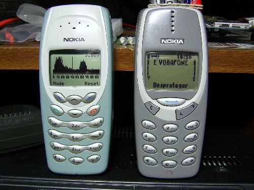

#Nokia Spectrum Analyzer
##AVR 2.4 GHz spectrum anayzer inside a Nokia 3410 case

This is an 2.4 GHz spectrum anayzer I build around 2013 inside a Nokia 3410 case. It was based on an ATmega8 microcontroller and the CYWM6935 radio module. I though the source code was lost but I found it deep within an old hard drive that I had kept in a drawer.

Nowadays, in an era where countless microcontrollers with built-in WiFi exist, and ever complete software defined radios inside (ESP32, I look at you!), this is completely obsolete but maybe it might still prove useful to someone.

##License

This software is made available under the GPLv3 license.
